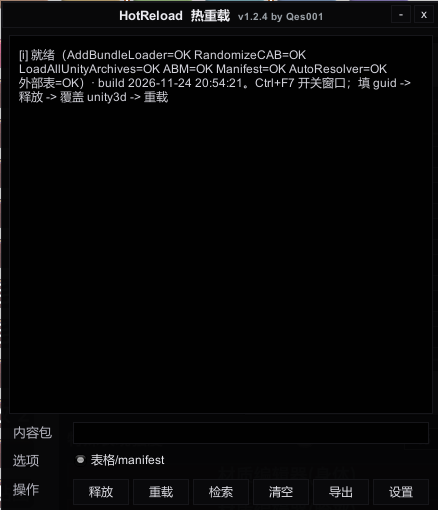

<h1 align="center">HotReload </h1>

<p align="center">
  不重启游戏，替换 zipmod 里的 <code>.unity3d</code> 后立即生效，并自动刷新场上角色的衣服/饰品/头发。
</p>

<p align="center">
  
</p>

---

## 支持环境

| 项目 | 目标 |
| --- | --- |
| `HotReload-Madevil` | Koikatu · Madevil / 经典 BepisPlugins（Sideloader 18.x，`Archives`） |
| `HotReload-RX22` | Koikatu · HF Patch / RX22（Sideloader 20.x，`Zipmods`） |
| `HotReload-KKS` | Koikatsu Sunshine · Sideloader 19.6 / 20.0（`Zipmods`），两个安装通用 |

反射适配，不编译依赖 `Sideloader.dll`。

> **KK 与 KKS 不能混用。** KKS 是 Unity 2019 的模块化程序集，`ChangeClothes / ChangeAccessory` 签名是 `(forceChange, update)`，Maker / Studio 单例走 `Singleton<T>.Instance`，因此单独出了一份 KKS payload；`HotReload-KKS` 已同时适配 Sideloader 19.6 与 20.0。

---

## 安装

```
BepInEx/
├─ plugins/HotReload.Boot.dll        壳，基本不用更新
└─ hotreload/HotReload.Payload.dll   主体，日常只换这个
```

游戏运行中也能直接覆盖 payload（壳会自动重读），`Ctrl+F10` 可强制重载。

---

## 使用

1. `Ctrl+F7` 打开窗口
2. 填 guid（多个用空格 / 逗号分隔）
3. **释放** → 把新的 `xxx.unity3d` 覆盖进 zipmod → **重载**
4. 角色部件会自动重建，无需重读卡片

| 键 | 作用 |
| --- | --- |
| `Ctrl+F7` | 开关窗口（**默认值**，可以在设置里改） |
| `Ctrl+F10` | 重载 payload（**默认值**，可以在设置里改；壳读同一份配置） |
| 其余动作 | 默认不绑定，进「设置」自己配 |

**设置 / 快捷键**：操作行 →「设置」→ 点「改键」后按下想要的组合键（`Esc` 取消），「默认/清除」恢复初始状态。开关窗口、payload 重载出厂带默认键，释放 / 重载 / 检索 / 清空 / 导出 默认全空，绑了才生效。快捷键只在窗口打开时生效，录制中或文本框输入时不会抢键。配置写在 `BepInEx/hotreload/hotkeys.txt`，删掉该文件即恢复出厂。

**表格/manifest**：只有改了 `list/characustom/*.csv` 或 `manifest.xml` 才勾选。

**检索**：游戏启动后才往 mods 目录里放的 zipmod，Sideloader 不会自己发现。点「检索」会重扫它扫过的目录（`ModsDirectory` + 额外目录），把**这次启动之后新增**的包连同表格一起注册，之后就能直接填它的 guid 用。

启动时会记一份基线（`BepInEx/hotreload/zipmods-seen.txt`，记录磁盘上已有的包），检索只处理基线之外的文件——否则 Sideloader 因「同 guid 多版本只载最新」而跳过的旧版本会被当成新包重新注册。基线每次启动自动重建，删掉也没事（下次启动重来）。

---

## 原理

- **释放**：摘注册表 → 卸加载器 → 关 zip 句柄
- **重载**：解析校验 → 把 bundle 抽到 `BepInEx/hotreload/bundle-cache` → 提交注册；失败则保留旧状态（`kept previous state`）
- 加载器指向缓存文件，Unity 不再锁 zipmod，源文件随时可覆盖
- 缓存按内容哈希，自动清理：超 **1 GB** 或 **15 天**未使用
- 刷新：`ChangeClothes / ChangeAccessory / ChangeHair(true)`（KKS 为 `(forceChange, update)`），并保护 MaterialEditor 材质数据

---

## 构建

```powershell
.\build.ps1                                  # 自动探测游戏目录，编译并部署
.\build.ps1 -BootOnly                        # 只更新壳
.\build.ps1 -GameDir                         # 指定游戏目录
```

`HotReload-KKS\build.ps1` 会把同一份 payload 同时部署到已知的两个 KKS 安装（`KoikatuSunshine`、`Koikatsu Sunshine EX BetterRepack R12`）。

---

## 常见问题

- **衣服/材质丢失**：看日志里 `注册=` 与 `载入OK name=...`，多半是 bundle 没注册上或 zipmod 的 AB 名不规范
- **文件仍被占用**：先点释放；仍占用就重启游戏一次
- **看不到改动**：切一次 outfit（角色用的是已实例化的 prefab）
- **列表里没有新衣服**：勾选「表格/manifest」再重载，然后切一次分类

---

## 许可

GPL-3.0-only，完整条款见 [LICENSE](LICENSE)。

实现思路参考 BepisPlugins 的 Sideloader 热重载分支（LGPL-3.0），未直接包含其源码。

---

## 更新记录

完整说明与附件见 [Releases](https://github.com/Qes001/HotReload/releases)。

### v1.2.4（2026-11-24）

- 修复：在「设置」页里按键不再触发已绑定的动作（之前会真的执行释放 / 重载 / 检索并刷日志）
- 修复：录键过程中窗口开关不响应，避免按到 `Ctrl+F7` 把窗口关掉
- 修复：录完键的当帧与下一帧做抑制，同一次按键不会顺手触发动作

### v1.2.3（2026-11-24）

- 新增：快捷键设置界面（操作行「设置」），可为 7 个动作绑键
- 开关窗口（`Ctrl+F7`）、payload 重载（`Ctrl+F10`）为默认值，**可自行修改**；其余动作默认不绑定
- 壳（Boot）改为从 `BepInEx/hotreload/hotkeys.txt` 读取 payload 重载键
- 操作行顺序：`释放` `重载` `检索` `清空` `导出` `设置`

### v1.2.2（2026-11-24）

- 新增：Koikatsu Sunshine 支持（`HotReload-KKS`，Sideloader 19.6 / 20.0 通用）
- 修复：「检索」漏扫额外 mod 目录（`AdditionalModsDirectory` 是属性而非字段）
- 变更：窗口标题署名改为 `by Qes001`

### v1.2.1（2026-11-24）

- 新增：「检索」按钮，游戏启动后新增的 zipmod 免重启注册
- 新增：启动基线 `zipmods-seen.txt`，只处理本次启动之后新增的包，自动跳过同 guid 的旧版本
- 修复：桥接初始化失败（HotReload 排在 Sideloader 之前加载时报「找不到 Sideloader.Sideloader」），改为惰性重试
- 修复：重载 / 检索总会刷新 `ZipArchives`（guid → 包路径）索引

### v1.2（2026-10-26）

- 表格/manifest 真正刷新：先删旧条目再按新数据补回（`Lists.LoadList` 只补缺不覆盖）
- 复用上次分配的 `LocalSlot`，重建 AutoResolver 的 `ResolveInfo`
- 替换 `Lists.ExternalDataList`，捏人界面重建列表才能看到新项
- manifest 改用非公开反射 `TryLoadFromZip` 解析
- 饰品列表逐项刷新，重载后跳一帧再刷一次
- 「表格/manifest」勾选状态存 `options.txt`

### v1.1 / v1.0.0

- 早期版本：释放 → 覆盖 unity3d → 重载 的基本流程，KK 首发
